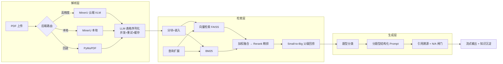

# FinQA 企业级财报智能问答系统

基于 RAG（检索增强生成）的财报智能问答系统：支持数百页年报 PDF 高精度解析入库，通过混合检索与多题型 Prompt 工程提供**带原文引用与页码溯源**的问答，并对资料中不存在的问题强制返回 N/A 拒绝编造。

> 在线展示页：https://luminous-cajeta-be76dc.netlify.app

## 核心特性

### 解析层 — 多后端路由 + 表格语义化
- **三后端自动路由**：MinerU 云端（VLM 高精度）→ MinerU 本地 → PyMuPDF，逐级回退、显式指定时不静默降级
- **LLM 表格序列化**：将 `营收 | 45,090 | 36,732` 类表格改写为"2024 年营业收入 45,090 百万元"的可检索事实句（6 路并发 + 指数退避重试 + 质量门控磁盘缓存）
- **超长文档处理**：云端解析自动按 200 页分片、批量提交、页码无缝拼接

### 检索层 — 三路召回 + 精排
- 向量（FAISS）+ BM25 + 查询扩展三路召回，加权融合
- Rerank 精排取 Top-K，**Small-to-Big** 策略回捞父级页面保上下文完整
- 按公司名称路由隔离多企业知识库

### 生成层 — 分题型 Prompt + 防编造闸门
- 数值 / 布尔 / 名单 / 对比 / 开放五类题型结构化 Prompt，强制思维链（CoT）
- 回答强制携带**引用来源与页码**，可回溯原文核对
- 口径不符（如归母净利润 vs 净利润）与库外问题一律返回 **N/A**，拒绝编造

### 运维闭环 — 可观测、可实验、可沉淀
- **知识库健康度检查**：LLM 扫描关键指标缺失与跨文档口径冲突
- **Doc2Query**：为切片生成补充检索问题，扩大召回覆盖面
- **切片 A/B 实验**：内置 Hit@5 / MRR 对照实验框架（实测 500 字/重叠 60 优于 800 字/重叠 100）
- **GraphRAG**：实体抽取 + 知识图谱，Local/Global 双检索模式，无图时优雅降级
- **对话知识沉淀**：将问答中确认的事实写回知识库
- 全链路错误自动落盘日志（`data/logs/error.log`），含堆栈与上下文

## 系统架构



## 实测效果（真实 API 端到端评估）

| 指标 | 结果 | 说明 |
|------|------|------|
| 检索 Hit@5 | **100%** | 20 道自动生成问题全部前 5 命中 |
| 检索 MRR | **0.90** | gold 页面平均排名第 1.3 |
| 生成正确性 | **5.0 / 5** | LLM 评审，数值/名单/跨文档题 |
| 忠实度 | **5.0 / 5** | 无编造、趋势表述逐字复述原文 |
| 防编造闸门 | **5/5 全部正确拒绝** | 库外问题（如未披露的未来目标）一律 N/A |
| 引用规范 | **5/6 带引用** | 唯一无引用项为 N/A 回答（本无需引用） |
| 流式首字延迟 | **0.7s** | qwen-plus 流式输出 |
| 切片 A/B | 500 字优于 800 字 | Hit@5 0.80 vs 0.70 |

> 评估方法：检索指标基于 LLM 自动生成问题 + 人工标注 gold 页面；生成质量由 LLM-as-judge 从正确性、忠实度、引用规范三维度打分；防编造测试用库外事实性问题验证。

## 快速开始

```bash
# 1. 安装依赖
pip install -r requirements.txt

# 2. 配置密钥
cp .env.example .env
# 编辑 .env，填入 DASHSCOPE_API_KEY（阿里云百炼 https://bailian.console.aliyun.com/）
# 可选：MINERU_API_TOKEN（https://mineru.net ，每天 2000 页免费云端高精度解析）

# 3. 启动
streamlit run app.py
```

打开 `http://localhost:8501`：
1. **文档入库**页：填公司名称 → 上传财报 PDF → 选择解析后端 → 入库
2. **智能问答**页：直接提问，回答带引用溯源与流式输出
3. **运维工具**页：健康度检查 / Doc2Query / 切片 A/B / GraphRAG / 知识沉淀

## 项目结构

```
├── app.py                    # Streamlit 入口（入库/问答/运维三页面）
├── finqa/
│   ├── config.py             # 全局配置（模型/切片/并发，均可用环境变量覆盖）
│   ├── llm.py                # DashScope 统一封装：Chat/Embedding/Rerank/流式
│   ├── store.py              # 知识库入口：入库流水线 + 按公司路由
│   ├── chunking.py           # 语义分块（父块存储，Small-to-Big 支撑）
│   ├── parsing/              # 解析层：MinerU 云端/本地、PyMuPDF、表格序列化
│   ├── indexing/             # 检索层：FAISS 向量库、BM25、加权融合
│   ├── generation/           # 生成层：题型分类、分题型 Prompt、流式回答
│   ├── graphrag/             # GraphRAG：实体抽取、图谱、Local/Global 检索
│   └── maintenance/          # 运维：健康检查、Doc2Query、A/B 实验、知识沉淀
└── showcase/                 # 项目展示页（单文件 HTML）
```

## 技术栈

Python 3.10+ · Streamlit · DashScope（Qwen / Embedding / Rerank）· FAISS · rank-bm25 · PyMuPDF · MinerU · NetworkX（GraphRAG）

## License

MIT
